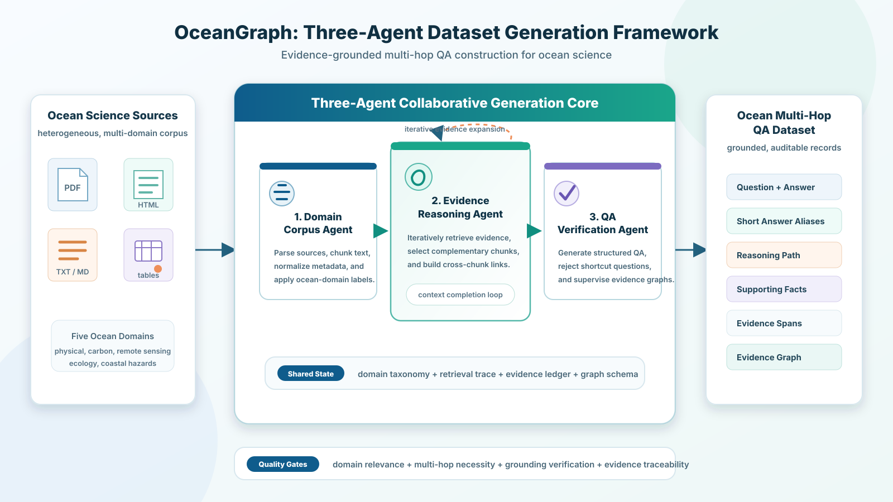

# OceanGraph-R1

<p align="center">
  <strong>A domain-aware multi-agent framework for building evidence-grounded ocean science multi-hop QA datasets.</strong>
</p>

<p align="center">
  
  
  
</p>

OceanGraph-R1 turns ocean-science corpora into structured, verifiable multi-hop
question-answer datasets for retrieval and reasoning evaluation. It accepts
PDF, HTML, TXT, and Markdown sources, plans domain-specific reasoning paths,
and verifies that each accepted question requires evidence from multiple chunks.

<p align="center">
  
</p>

## Highlights

- **Ocean-domain planning** — Uses a five-domain ocean taxonomy covering
  physical oceanography and climate, carbon and biogeochemistry, remote sensing
  and observing systems, marine ecology and fisheries, and coastal hazards and
  human systems.
- **Evidence-grounded multi-hop QA** — Builds reasoning paths, supporting
  facts, and evidence spans, then rejects questions that can be answered from a
  single chunk.
- **Multimodal-ready ingestion** — Processes PDF, HTML, TXT, and Markdown
  sources into a common retrieval and chunking workflow.
- **Structured outputs** — Exports accepted and rejected QA pairs as JSON and
  JSONL together with chunks and completed context.
- **Configurable model backends** — Supports Gemini, OpenAI, and local Ollama
  backends, with configurable embedding and reranking models.

## Installation

```bash
git clone <YOUR_REPOSITORY_URL>
cd OceanGraph
python -m venv .venv
```

Activate the virtual environment, then install the package:

```bash
pip install -e .
```

For evaluation dependencies:

```bash
pip install -e ".[eval]"
```

## Quick start

Set the API key for your selected backend:

```bash
# PowerShell
$env:OPENAI_API_KEY = "YOUR_OPENAI_KEY"

# bash / zsh
export OPENAI_API_KEY="YOUR_OPENAI_KEY"
```

Run an OceanGraph pipeline over an input directory:

```bash
python run_oceangraph.py \
  --input data/ocean_texts \
  --output output/oceangraph_demo \
  --backend openai \
  --embedding-model bge_m3 \
  --reranker-model text_embedding \
  --num-qa-pairs 20 \
  --max-depth 2 \
  --min-supporting-chunks 2
```

Or use the installed command:

```bash
oceangraph \
  --input data/ocean_texts \
  --output output/oceangraph_demo \
  --backend gemini \
  --api-key YOUR_GEMINI_KEY \
  --num-qa-pairs 20
```

Run environment checks before a full job:

```bash
python run_oceangraph.py --preflight
```

## Pipeline

OceanGraph-R1 coordinates three stages:

1. **Domain Corpus Agent** labels source material using the ocean taxonomy and
   assembles high-value multi-chunk contexts.
2. **Evidence Reasoning Agent** generates questions, answers, sub-questions,
   reasoning paths, and citation-ready evidence spans.
3. **QA Verification Agent** validates evidence coverage and strict multi-hop
   requirements before accepting an item.

The default strict verifier tests whether a candidate can be answered from any
single chunk. Use `--no-strict-multihop` only when this guard is intentionally
not required.

## Output

A completed run writes the following key artifacts to the output directory:

| File | Description |
| --- | --- |
| `qa_multihop_pass.json` | Accepted multi-hop QA pairs |
| `qa_multihop_pass.jsonl` | JSONL version of accepted QA pairs |
| `qa_multihop_fail.json` | Rejected candidates and verification details |
| `qa_multihop_fail.jsonl` | JSONL version of rejected candidates |
| `chunks.json` | Source chunks used by the pipeline |
| `chunks_with_complete_context.json` | Context-expanded chunks |
| `oceangraph_run_config.json` | Run metadata and selected configuration |

Each accepted record includes fields such as `question_type`, `answer_type`,
`subdomain`, `declared_hop_count`, `sub_questions`, `reasoning_path`,
`supporting_facts`, and `evidence_spans`.

## Ocean taxonomy

The built-in taxonomy in `src/oceangraph/ocean_taxonomy.yaml` contains five
primary research domains:

1. Physical oceanography and climate
2. Carbon cycle and marine biogeochemistry
3. Remote sensing and observing systems
4. Marine ecology and fisheries
5. Coastal hazards and human systems

See `OCEAN_5_DOMAIN_DATASET.md` for the recommended corpus and dataset
organization, and `OCEANGRAPH_FRAMEWORK.md` for a detailed framework overview.

## Command-line options

```text
--input, -i                 Directory containing PDF, HTML, TXT, or Markdown inputs
--output, -o                Destination for generated dataset artifacts
--backend, -b               gemini, openai, or ollama
--embedding-model           auto, qwen3_vl, nomic, or bge_m3
--reranker-model            gemini_vlm, qwen3_vl, or text_embedding
--num-qa-pairs              Target number of accepted QA pairs
--max-depth                 Maximum multi-hop retrieval depth
--min-supporting-chunks     Minimum distinct chunks for strict verification
--no-strict-multihop        Disable the single-chunk shortcut check
--no-jsonl                  Disable JSONL output copies
--preflight                 Run environment checks only
```

## Project layout

```text
OceanGraph/
├── src/oceangraph/         # OceanGraph public CLI and taxonomy
├── src/mirage/             # Core multi-agent generation engine
├── scripts/                # Dataset and conversion helpers
├── figures/                # Framework illustrations
├── run_oceangraph.py       # Standalone entry point
├── OCEANGRAPH_FRAMEWORK.md # Detailed framework description
└── OCEAN_5_DOMAIN_DATASET.md
```

## License

This project is licensed under the [Apache License 2.0](LICENSE).
