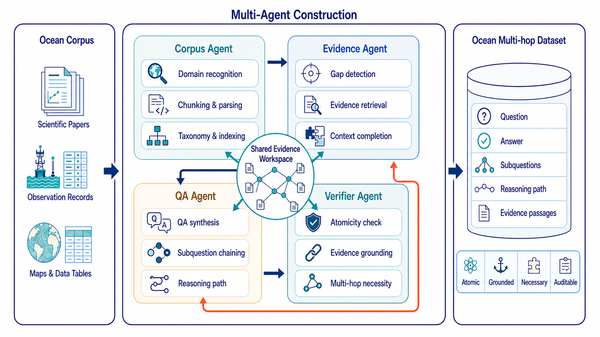

# OceanGraph-R1

<p align="center">
  <strong>A domain-aware multi-agent framework for building evidence-grounded ocean science multi-hop QA datasets.</strong>
</p>

<p align="center">
  
  
  
  
</p>

**Current release:** `v2.2.1` ·
**Last updated:** `2026-07-21`

OceanGraph-R1 turns ocean-science corpora into structured, verifiable multi-hop
question-answer datasets for downstream retrieval and reasoning training. It accepts
PDF, HTML, TXT, and Markdown sources, plans domain-specific reasoning paths,
and verifies that each accepted question requires evidence from multiple chunks.

<p align="center">
  
</p>

## Highlights

- **Ocean-domain planning** — Uses a five-domain ocean taxonomy covering
  physical oceanography and climate, carbon and biogeochemistry, remote sensing
  and observing systems, marine ecology and fisheries, and coastal hazards and
  human systems.
- **Atomic evidence-grounded multi-hop QA** — Asks for one minimal final
  answer while preserving hidden multi-step reasoning paths, supporting facts,
  and evidence spans; compound questions and single-chunk shortcuts are rejected.
- **Text-only corpus generation** — Converts PDF, HTML, TXT, and Markdown
  sources into text chunks and never sends extracted images to model APIs.
- **Structured outputs** — Exports accepted and rejected QA pairs as JSON and
  JSONL together with chunks and completed context.
- **Configurable model backends** — Supports Gemini, OpenAI, and local Ollama
  backends, with configurable embedding and reranking models.

## Installation

```bash
git clone https://github.com/zhangxj0/OceanGraph.git
cd OceanGraph
python -m venv .venv
```

Activate the virtual environment, then install the package:

```bash
pip install -e .
```

For migration to the validated Paratera NVIDIA image, reuse its preinstalled
Torch build and install the exact versions from `requirements.txt`:

```bash
python -m pip install --user --break-system-packages --no-deps \
  -r requirements.txt
python -m pip install --user --break-system-packages -e . --no-deps
```

`faiss-cpu` is required by multi-hop vector retrieval. Docling is no longer
required for TXT/Markdown inputs; PDF/HTML ingestion remains an optional
document-processing path.

Evaluation uses the configured DeepSeek verification route and the same local
BGE-M3 installation as retrieval; no Gemini, LangChain, or RAGAS packages are
required.

For the validated Qwen generation plus DeepSeek verification setup,
isolated-server deployment, validation criteria, and Search-R1 conversion
steps, see [REPRODUCIBILITY.md](REPRODUCIBILITY.md).

## Quick start

Set the API key for your selected backend:

```bash
# PowerShell
$env:OPENAI_API_KEY = "YOUR_OPENAI_KEY"

# bash / zsh
export OPENAI_API_KEY="YOUR_OPENAI_KEY"
```

For the recommended stage-routed setup, keep credentials in environment
variables. Model endpoints and names now live only in `configs/llm.yaml`:

```powershell
Copy-Item configs/oceangraph.yaml.example config.yaml
# Edit configs/llm.yaml when either model or endpoint changes.
$env:PARATERA_API_KEY = "YOUR_PARATERA_KEY"
$env:DEEPSEEK_API_KEY = "YOUR_DEEPSEEK_KEY"
```

This routes corpus analysis, retrieval, and QA generation to
`Qwen3.7-Plus` through Paratera, while final text-only verification uses
`deepseek-v4-pro`. The default `cost_efficient` policy first rejects obvious
compound questions, hidden-context references, and long answers locally. Each
remaining candidate uses one DeepSeek call that jointly checks standalone form,
answer grounding, content dependence, and support from at least two chunks.
Model selection, counterfactual audits, and automatic correction are disabled
by default, so a failed candidate is skipped instead of triggering repeat API
calls.

Accepted records contain exactly one visible question and one canonical ground
truth. `answer` and `short_answers[0]` must match after punctuation trimming and
are limited by default to 12 whitespace-delimited words or 16 Chinese characters,
making exact-match reward computation deterministic. Canonical `answer_type`
values are `entity`, `numeric`, `date`, `yes_no`, and `short_text`; open-ended
`description` and multi-value `list` targets are excluded. The default
`pipeline.modality: text` setting strips image artifacts before retrieval,
generation, verification, and dataset export.

Run an OceanGraph pipeline over an input directory:

```bash
python run_oceangraph.py \
  --config config.yaml \
  --input data/ocean_texts \
  --output output/oceangraph_demo \
  --backend openai \
  --embedding-model bge_m3 \
  --offline-models \
  --reranker-model text_embedding \
  --num-qa-pairs 20 \
  --max-depth 2 \
  --min-supporting-chunks 2
```

Use `--offline-models` on isolated servers after the embedding model has been
cached locally. The equivalent YAML setting is
`embedding.local_files_only: true`; both forms prevent Hugging Face network
probes while retaining local GPU inference.

Or use the installed command:

```bash
oceangraph \
  --input data/ocean_texts \
  --output output/oceangraph_demo \
  --backend gemini \
  --api-key YOUR_GEMINI_KEY \
  --num-qa-pairs 20
```

Run environment checks before a full job:

```bash
python run_oceangraph.py --preflight
```

## Pipeline

OceanGraph-R1 coordinates four explicit runtime agents:

1. **Corpus Agent** parses and chunks source material, recognizes the ocean
   domain, and builds the taxonomy-aware retrieval index.
2. **Evidence Agent** detects missing information, retrieves complementary
   evidence, and completes a multi-chunk context.
3. **QA Agent** synthesizes atomic questions, minimal answers, hidden
   sub-questions, and reasoning-path annotations.
4. **Verifier Agent** independently checks atomicity, evidence grounding, and
   multi-hop necessity before accepting an item.

The agents reuse the validated v2.1 generation functions through explicit v2.2.1
runtime boundaries. Every generated or rejected record contains an
`agent_trace` and `coordination_trace` showing which role ran, the feedback
route, and the final state of each candidate.

The default `balanced` verifier keeps the single-chunk shortcut guard but checks
up to four evidence-prioritized chunks in one consolidated DeepSeek request. It
accepts a candidate when no checked chunk can answer alone and at least two
chunks provide partial evidence; one unparseable chunk verdict is tolerated.
Irrelevant background chunks do not cause rejection.

For an accepted candidate with `N` context chunks, the previous default used
`2 + 2N` verifier requests: model selection, full QA verification, `N`
single-chunk checks, and `N` leave-one-out checks. The recommended default uses
two requests: full QA verification plus one consolidated multi-hop check. With
four chunks this reduces verifier request count from 10 to 2. Use
`multihop_verification_mode: strict`, `model_selection: true`, and
`counterfactual_verification: true` only for exhaustive audit subsets.

## Output

A completed run writes the following key artifacts to the output directory:

| File | Description |
| --- | --- |
| `qa_multihop_pass.json` | Accepted multi-hop QA pairs |
| `qa_multihop_pass.jsonl` | JSONL version of accepted QA pairs |
| `qa_multihop_fail.json` | Rejected candidates and verification details |
| `qa_multihop_fail.jsonl` | JSONL version of rejected candidates |
| `chunks.json` | Source chunks used by the pipeline |
| `chunks_with_complete_context.json` | Context-expanded chunks |
| `oceangraph_run_config.json` | Run metadata and selected configuration |
| `oceangraph_run_manifest.json` | Corpus/config fingerprint preventing mixed-run reuse |
| `training/train.jsonl` | Compact, fully verified multi-agent records for training |
| `training/corpus.jsonl` | Retrieval corpus with IDs aligned to the evidence graph |
| `training/manifest.json` | Export counts and rejected-record reasons |

Each accepted record includes fields such as `question_type`, `answer_type`,
`subdomain`, `hop_count`, `declared_hop_count`, `retrieval_hop_count`,
`sub_questions`, `reasoning_path`,
`supporting_facts`, `evidence_spans`, and the four-stage `agent_trace`.

In v2.2.1, `hop_count` has one dataset-level meaning: the number of distinct
verified evidence chunks required to answer the question. Retrieval expansion
steps are stored separately as `retrieval_hop_count`.

The automatic training export is strict: records are excluded if multi-hop
verification did not pass, fewer than two supporting chunks were grounded,
the hop label disagrees with the evidence graph, or any of the four Agent
events is missing. The same export is available through
`results.export_training("path/to/training")`.

## Ocean taxonomy

The built-in taxonomy in `src/oceangraph/ocean_taxonomy.yaml` contains five
primary research domains:

1. Physical oceanography and climate
2. Carbon cycle and marine biogeochemistry
3. Remote sensing and observing systems
4. Marine ecology and fisheries
5. Coastal hazards and human systems

See `OCEAN_5_DOMAIN_DATASET.md` for the recommended corpus and dataset
organization, and `OCEANGRAPH_FRAMEWORK.md` for a detailed framework overview.

## Command-line options

```text
--input, -i                 Directory containing PDF, HTML, TXT, or Markdown inputs
--output, -o                Destination for generated dataset artifacts
--backend, -b               gemini, openai, or ollama
--embedding-model           bge_m3, bge_large, or auto
--offline-models            Use only locally cached Hugging Face models
--reranker-model            text_embedding
--num-qa-pairs              Target number of accepted QA pairs
--max-depth                 Maximum multi-hop retrieval depth
--min-supporting-chunks     Minimum distinct chunks for strict verification
--multihop-verification-mode {balanced,strict}
                            Choose consolidated or exhaustive shortcut checks
--max-verification-chunks   Cap evidence chunks checked in balanced mode
--max-unknown-verdicts      Allowed uncertain verdicts in balanced mode
--model-selection           Enable optional model-based candidate selection
--counterfactual-verification
                            Enable leave-one-out checks in strict mode
--no-counterfactual-verification
                            Disable leave-one-out evidence necessity checks
--no-strict-multihop        Disable the single-chunk shortcut check
--no-jsonl                  Disable JSONL output copies
--preflight                 Run environment checks only
```

## Project layout

```text
OceanGraph/
├── src/oceangraph/         # Unified public API and generation engine
├── scripts/                # Dataset and conversion helpers
├── figures/                # Framework illustrations
├── run_oceangraph.py       # Standalone entry point
├── OCEANGRAPH_FRAMEWORK.md # Detailed framework description
└── OCEAN_5_DOMAIN_DATASET.md
```

## License

This project is licensed under the [Apache License 2.0](LICENSE).
